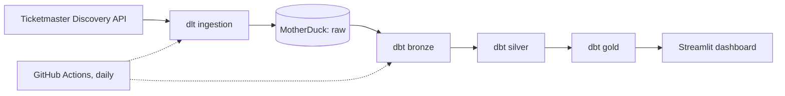

# Ticketmaster Market Analytics Pipeline

An automated ELT pipeline and dashboard that measures event supply, ticket pricing, and booking lead times across three major US entertainment markets. Event data is extracted from the Ticketmaster Discovery API, loaded into MotherDuck, transformed with dbt, and served through a Streamlit dashboard. A GitHub Actions workflow refreshes everything daily.

[View Live Dashboard](https://ticketmaster-analytics-pipeline-wytxg2ea9nrwe96ufphppf.streamlit.app/)

## Business Context

The pipeline answers three questions for event promoters, tour managers, and ticket brokers across **New York, Los Angeles, and Chicago** and the **Music, Sports, and Arts & Theatre** segments:

| Question | Metric | Use |
| --- | --- | --- |
| Where is event supply concentrated? | Upcoming event volume by city and segment | Compare market activity when planning tour routing |
| What do primary-market tickets cost? | Average minimum and maximum listed price by city and segment | Compare price floors and ceilings across markets |
| How early do on-sales open? | Median days between public on-sale date and event date | Estimate how far ahead marketing spend should start |

## Architecture



| Layer | Technology | Responsibility |
| --- | --- | --- |
| Ingestion | Python, dlt | Paginated API extraction with retries, deduplication, and normalization of nested JSON |
| Storage | MotherDuck | Serverless cloud DuckDB warehouse |
| Transformation | dbt Core (dbt-duckdb) | Bronze, silver, and gold models with schema tests |
| Orchestration | GitHub Actions | Daily scheduled run, with manual trigger |
| Presentation | Streamlit, Altair | Interactive dashboard on the gold layer |

## Data Model

| Layer | Materialization | Description |
| --- | --- | --- |
| `raw` | Tables (dlt) | `ticketmaster_events` and `ticketmaster_events__price_ranges`, as loaded from the API |
| `bronze_events` | View | Joins events to their price ranges on dlt's parent key, renames columns, and casts prices to numeric types |
| `silver_events` | View | One row per event. Collapses multiple price ranges to the event's overall minimum and maximum, keeps missing prices as `NULL`, and calculates lead time in days. Lead times outside 0 to 730 days are set to `NULL` |
| `gold_metrics` | Table | One row per city and segment: event count, average prices, average and median lead time, and the sample sizes behind each metric |

## Ingestion Design

- **Date windowing.** The API returns at most about 1,000 results for any single query. The extractor therefore requests each city and segment in 7-day windows across the next 365 days, so each query stays below that limit. If a window still exceeds it, the script prints a warning naming the window.
- **Resilience.** Requests use a timeout, a short delay between calls, and exponential backoff on timeouts, rate limits (HTTP 429), and server errors (HTTP 5xx). Windows that fail after all retries are reported at the end of each city and segment so the run can be repeated.
- **Deduplication.** Events that appear in more than one window are dropped by event ID.
- **Full refresh.** Each run replaces the raw tables, so the warehouse always reflects the latest API state.

## Data Quality

- `silver_events.event_id` is tested for `unique` and `not_null` on every dbt run.
- Metrics are only as strong as the rows behind them. The gold table carries `priced_events` and `valid_lead_time_events`, and the dashboard uses them to weight averages and to hide groups with fewer than 30 observations.
- The dashboard header states what share of events have price data and a valid lead time, calculated from the current data.

## Known Limitations

- **Price coverage is partial.** Ticketmaster does not publish price ranges for many events, particularly outside Music. Price metrics describe only events that list a price, and some city and segment groups have too few priced events to display.
- **Prices are primary-market face values.** They do not reflect resale prices and should not be read as a measure of broker margin or resale demand.
- **Event volume is not saturation.** Counts have no denominator such as population or venue capacity, so they compare activity between markets without measuring over- or under-supply.
- **Lead time is bounded.** Some events carry placeholder or inconsistent on-sale dates. Values outside 0 to 730 days are excluded rather than corrected.
- **Limited horizon.** Only events with an announced date within the next 365 days are included.

## Repository Structure

```
.
|-- .github/workflows/daily_pipeline.yml   Scheduled extract, transform, and test run
|-- ticketmaster_pipeline.py               dlt extraction pipeline
|-- app.py                                 Streamlit dashboard
|-- requirements.txt                       Pinned dependencies
`-- ticketmaster_transforms/               dbt project
    |-- dbt_project.yml
    |-- profiles.yml                       MotherDuck connection (token from environment)
    `-- models/
        |-- bronze/                        bronze_events.sql, sources.yml
        |-- silver/                        silver_events.sql, schema.yml
        `-- gold/                          gold_metrics.sql
```

## Setup

### Prerequisites

- Python 3.13
- A [Ticketmaster developer](https://developer.ticketmaster.com/) API key
- A [MotherDuck](https://motherduck.com/) account and access token

### Install

```bash
python -m venv .venv
# Windows:      .venv\Scripts\activate
# macOS/Linux:  source .venv/bin/activate
pip install -r requirements.txt
```

### Configure credentials

Create `.dlt/secrets.toml` (already excluded from version control):

```toml
[sources]
api_key = "<ticketmaster-api-key>"

[destination.motherduck.credentials]
password = "<motherduck-token>"
```

Set the token for dbt in your shell:

```bash
# Windows PowerShell:  $env:MOTHERDUCK_TOKEN = "<motherduck-token>"
# macOS/Linux:         export MOTHERDUCK_TOKEN="<motherduck-token>"
```

For the dashboard, create `.streamlit/secrets.toml` (also excluded from version control):

```toml
MOTHERDUCK_TOKEN = "<motherduck-token>"
```

### Run

```bash
# 1. Extract and load
python ticketmaster_pipeline.py

# 2. Transform and test
cd ticketmaster_transforms
dbt run --profiles-dir .
dbt test --profiles-dir .
cd ..

# 3. Launch the dashboard
streamlit run app.py
```

## Automation

`.github/workflows/daily_pipeline.yml` runs daily at 00:00 UTC and can also be started manually from the Actions tab. It installs dependencies, runs the extraction, then runs `dbt run` and `dbt test`.

The repository needs two secrets under Settings, Secrets and variables, Actions:

| Secret | Purpose |
| --- | --- |
| `TICKETMASTER_API_KEY` | Discovery API access |
| `MOTHERDUCK_TOKEN` | Warehouse access for dlt and dbt |

## Possible Extensions

- Additional dbt tests: accepted values for city and segment, and a freshness check on the raw tables.
- Per-capita or per-venue normalization to turn event volume into a true saturation measure.
- Historical snapshots, so changes in volume and pricing can be tracked over time instead of replacing each day's data.